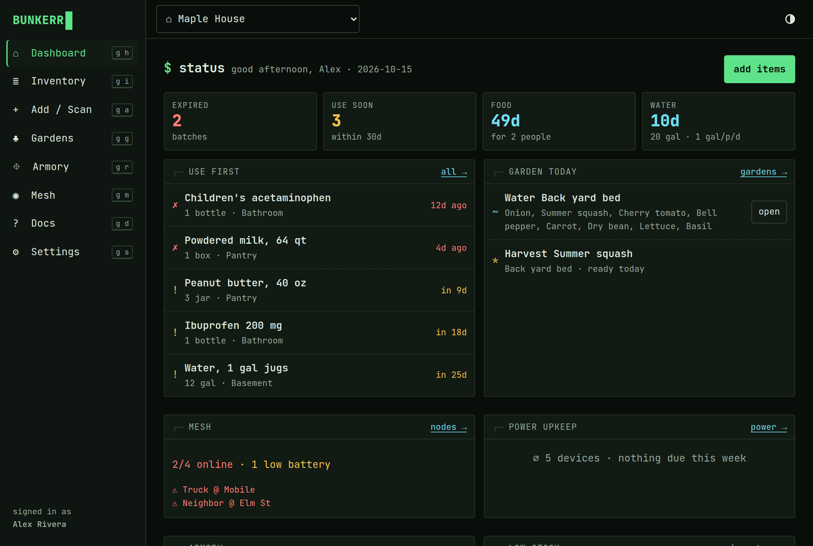
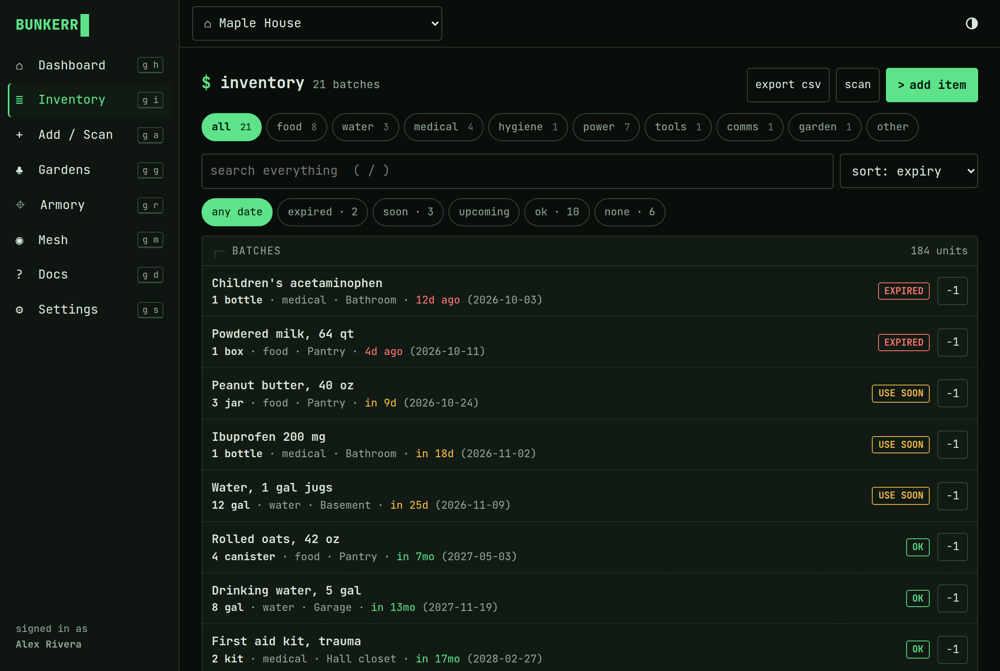
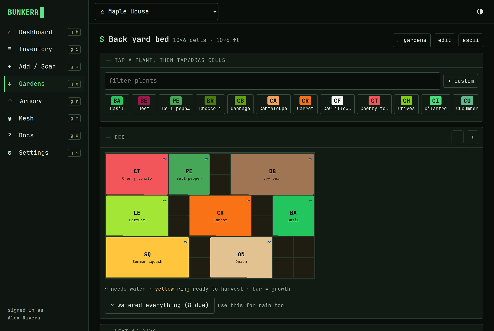
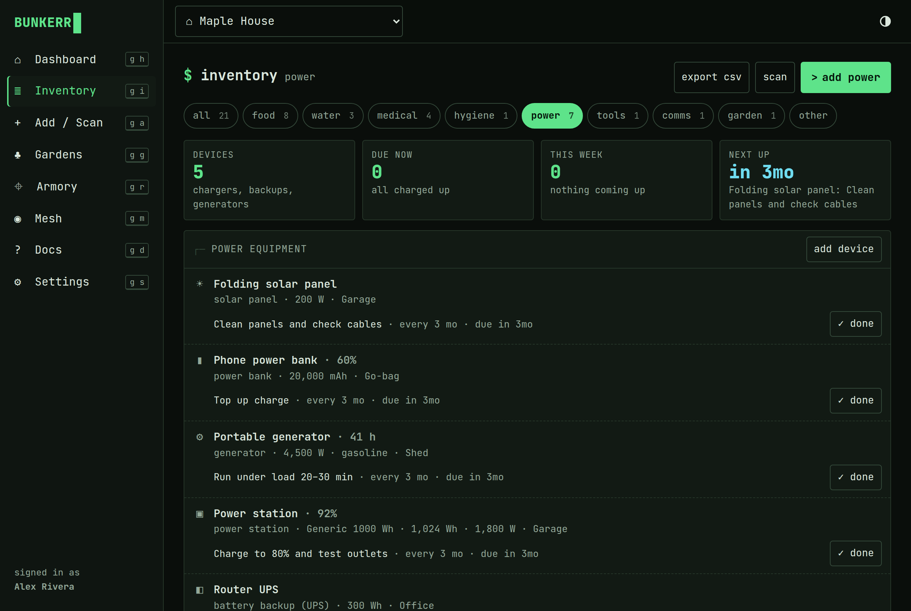
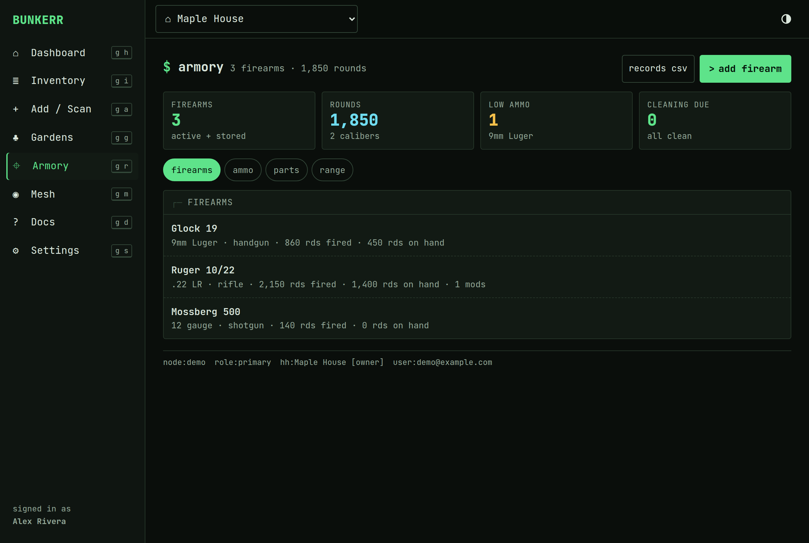
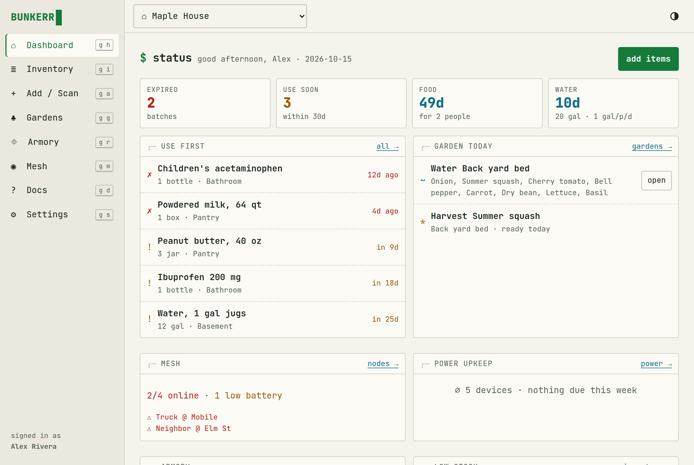
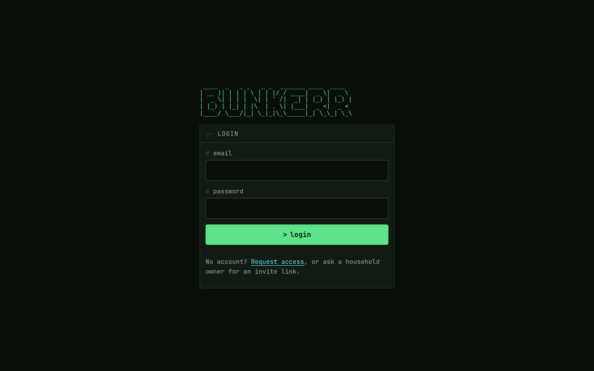
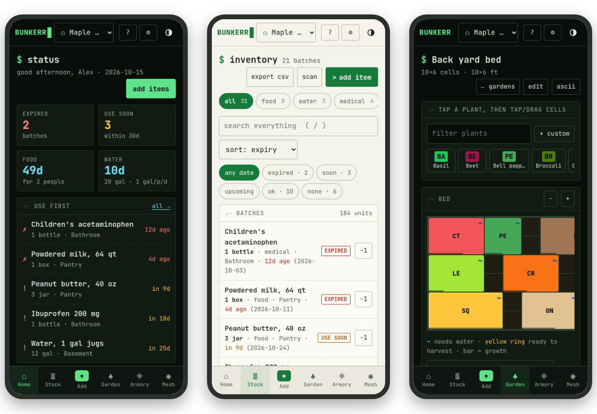

<div align="center">

# ▌BUNKERR

**A self-hosted emergency-prep tracker for your household**

Know what's on the shelves, what expires next, and how many days of food and water you have.<br>
Terminal-styled, built for phones, and it keeps working when the internet doesn't.




</div>

## Contents

- [What it does](#what-it-does)
- [Gallery](#gallery)
- [On your phone](#on-your-phone)
- [Install](#install)
- [Put it behind HTTPS](#put-it-behind-https)
- [First steps](#first-steps)
- [Configuration](#configuration)
- [Updating](#updating)
- [Backups](#backups)
- [Optional extras](#optional-extras)
- [Removing it](#removing-it)
- [Development](#development)
- [Under the hood](#under-the-hood)
- [Documentation](#documentation)
- [Credits and licence](#credits-and-licence)

## What it does

**Inventory and readiness**
- **Nine sections:** food, water, medical, hygiene, power, tools, comms, garden and other.
- **Expiry tiers:** every batch is *expired*, *use soon*, *upcoming* or *ok*, and the
  dashboard lists what to **use first**.
- **Days of food and water:** worked out from calories and gallons for the people in your
  household.
- **Low-stock minimums** per item, and a CSV export to print for the go-bag.

**Fast entry**
- **Barcode scanning** with the phone camera or a USB/Bluetooth scanner. It checks an
  offline copy of USDA FoodData Central and Open Food Facts (~970k US products, calories
  filled in) first, then online databases.
- **Quick add** with suggestions for ~170 common prep staples. It remembers your usual unit,
  category and location.
- **Receipt / shelf photos** read by Claude, reviewed in an editable table before saving.
  This one is optional and needs an Anthropic API key.

**Around the house**
- **Power equipment:** power banks, power stations, UPSes, generators and solar, with
  charge and run-under-load reminders.
- **Gardens:** a grid planner with planting, germination and harvest dates, and watering
  reminders.
- **Meshtastic:** node health (last heard, battery, signal) from your own MQTT broker.
- **Armory:** firearms, parts, ammunition with caliber matching, and a range log. Serials
  are masked, viewers don't see it unless you allow it, and a household can turn it off.

**People and alerts**
- **Households** with *owner*, *member* and *viewer* roles. Signup is invite-only. One
  person can belong to several households, and each household's data is kept separate.
- **Alerts:** a daily digest plus urgent alerts by email, Discord, ntfy or a webhook router.
- **Linked households:** link with a household on someone else's Bunkerr server. Each side
  picks what to share (readiness summary, inventory, power, mesh status; never the armory).
  The two servers can also relay a shared Meshtastic channel.

**Resilience**
- **Offline:** each device keeps a saved copy, and changes made offline sync later without
  being applied twice.
- **Optional failover:** a standby server keeps a copy and takes over automatically through
  Cloudflare if the main one goes down.

## Gallery

| Inventory | Garden planner |
|:---:|:---:|
|  |  |
| Every batch with its expiry tier, filters by section and date, and a one-tap *use one*. | Paint plants onto a grid. `~` marks beds due for water; the bar shows growth. |

| Power equipment | Armory |
|:---:|:---:|
|  |  |
| Charge, maintenance and run reminders for everything that keeps the lights on. | Firearms, ammo on hand per caliber, low-ammo warnings and cleaning intervals. |

| Light theme | Login |
|:---:|:---:|
|  |  |
| Dark terminal by default; one tap switches to light. | Invite-only. Strangers can *request access*, which an admin approves. |

## On your phone

Bunkerr is a mobile-first web app. Open it in your phone's browser and choose *Add to Home
Screen* to install it like an app, with a bottom tab bar and camera scanning.

<p align="center"></p>

> [!NOTE]
> Installing it as an app and using the camera both need **HTTPS** (or `localhost`). A plain
> `http://LAN-IP:8787` is fine for trying it out from a computer.

## Install

You need a Linux host with **Docker** and **Docker Compose v2**: a home server, a NAS
(Unraid, TrueNAS, Synology), a small VPS or a Raspberry Pi 4/5. Bunkerr uses about 300 MB of
RAM and 500 MB of disk, plus your data.

```bash
git clone https://github.com/TheMooseSaysMoo/bunkerr.git
cd bunkerr
./setup.sh
```

`setup.sh` asks for the address people will open and your timezone, then:
1. creates `.env` from [`.env.example`](.env.example) with a freshly generated
   `INTERNAL_SECRET`;
2. makes `data/` writable by the app (uid 1000 inside the container);
3. builds and starts the container, and waits until it's healthy;
4. creates the first admin account and your household. It asks for a password (at least 10
   characters).

Open the address it prints and log in. The first build takes a few minutes.

**Keep a copy of `.env` somewhere safe.** It holds the secret that encrypts your saved
email password.

<details>
<summary><b>Install by hand instead</b></summary>

```bash
cp .env.example .env
$EDITOR .env                       # set PUBLIC_URL, TZ, and INTERNAL_SECRET (openssl rand -hex 32)
mkdir -p data && sudo chown 1000:1000 data
docker compose up -d --build
docker compose exec bunkerr node server/dist/cli.js create-admin you@example.com "Your Name" "Your household"
```

</details>

<details>
<summary><b>Run it without prompts (scripts, Ansible, cloud-init)</b></summary>

```bash
PUBLIC_URL=https://bunkerr.example.com TZ=America/Chicago \
ADMIN_EMAIL=you@example.com ADMIN_NAME="Your Name" BUNKERR_PASSWORD='a-long-password' \
./setup.sh
```

</details>

## Put it behind HTTPS

Put any reverse proxy in front of port 8787 and set `PUBLIC_URL` in `.env` to the https
address. Then run `docker compose up -d` to apply it.

- **Caddy** (gets certificates automatically):
  ```
  bunkerr.example.com {
      reverse_proxy 127.0.0.1:8787
      request_body max_size 16MB
  }
  ```
- **Nginx Proxy Manager, Traefik or nginx:** forward to `http://<host>:8787` and allow
  request bodies up to 16 MB (for receipt photos). Websockets aren't needed.
- **Cloudflare Tunnel** (no open ports): an ingress rule
  `bunkerr.example.com → http://localhost:8787`.

If the proxy runs on the same machine, set `BUNKERR_BIND=127.0.0.1:8787` so the app isn't
reachable from the LAN directly. Full details are in [docs/03-deploy.md](docs/03-deploy.md).

## First steps

1. **Set *people in household*** in Settings, so the *days of food and water* figures are
   right.
2. **Stock the shelves** from **Add**: quick add, scan barcodes, or photograph a receipt.
3. **Set up alerts:** Settings → *email (SMTP)* for the instance, then each household picks
   email, Discord or ntfy under *alerts & notifications*.
4. **Invite people:** Settings → Household → *create invite*. The link works once and
   expires after 7 days.
5. **Install it on your phone** (see above) and take it for a walk around the pantry.

[Using Bunkerr](docs/01-using-bunkerr.md) walks through every screen.

## Configuration

Everything lives in `.env`. [`.env.example`](.env.example) explains every setting; a single
server only needs the first block. Email, Discord and ntfy are set up inside the app, not
here.

| Setting | What it does |
|---|---|
| `PUBLIC_URL` | The address people open. `https://` turns on secure cookies. |
| `TZ` | Timezone for expiry dates, digests and reminders. |
| `INTERNAL_SECRET` | Random secret (`setup.sh` makes one). Encrypts the saved SMTP password. |
| `BUNKERR_BIND` | Host port. `8787` for all interfaces, `127.0.0.1:8787` for a proxy on the same host. |
| `ANTHROPIC_API_KEY` | Turns on receipt / shelf photo import. Empty = off. |
| `BARCODE_MIRROR` | Offline barcode database (~140 MB in `data/`). `off` to skip it. |
| `MQTT_URL`, `MQTT_TOPICS` | Your Meshtastic MQTT broker. Empty = mesh off. |
| `FEDERATION` | Linked households with other Bunkerr servers. On by default. |
| `WEBHOOK_ROUTER_URL`, `HUB_TOKEN`, `PEER_URL` | Webhook router, family-portal signup and failover. All off unless set. |

> [!IMPORTANT]
> `.env` is gitignored and must never be committed. It's the only place your secrets and
> API keys belong.

After editing `.env`, run `docker compose up -d`. A plain `restart` doesn't reload it; the
container has to be recreated.

## Updating

```bash
./deploy.sh
```

It fetches the latest `main`, rebuilds, restarts and waits for the health check, then
prints a one-line rollback command. Database migrations run automatically. `.env` and
`data/` are never touched.

It **refuses to run** if the checkout has local changes, so nothing gets silently
overwritten. Commit them to your fork first, or set `FORCE=1` to discard them. `BRANCH=`
deploys another branch.

## Backups

All your data is one SQLite file, `data/bunkerr.db`.

- **Every night at 03:41** Bunkerr writes a consistent copy to
  `data/backups/bunkerr-YYYY-MM-DD.db` and keeps 14 days. Point your backup tool at
  `data/backups/`.
- Don't `cp` the live `bunkerr.db` while the app is running. Its write-ahead log can make
  the copy incomplete.
- `data/barcodes.db` is downloaded public data and rebuilds itself, so it doesn't need
  backing up.
- Also keep a copy of `.env`.

**Restore:**

```bash
docker compose stop bunkerr
cp data/backups/bunkerr-2026-10-01.db data/bunkerr.db
rm -f data/bunkerr.db-wal data/bunkerr.db-shm
docker compose start bunkerr
```

## Optional extras

| Feature | How to turn it on |
|---|---|
| Email alerts and invites | Settings → instance admin → email (SMTP) |
| Discord / ntfy alerts | Settings → alerts & notifications (per household) |
| Receipt / shelf photo import | `ANTHROPIC_API_KEY` in `.env` |
| Meshtastic node health | `MQTT_URL` in `.env`. A ready-made Mosquitto broker is in [`deploy/mosquitto/`](deploy/mosquitto/). See [docs/05](docs/05-meshtastic-mqtt.md) |
| Linked households | On by default once `PUBLIC_URL` is a public https address. See [docs/13](docs/13-linked-households.md) |
| Webhook router (Home Assistant-style webhooks) | `WEBHOOK_ROUTER_URL`. See [docs/06](docs/06-notifications.md) |
| Account creation from a family portal | `HUB_TOKEN`. See [docs/08](docs/08-onboarding-a-household.md) |
| A second server with automatic failover | See [docs/04](docs/04-failover.md) |

**Admin commands:**

```bash
docker compose exec bunkerr node server/dist/cli.js create-admin you@example.com "Name" "Household"
docker compose exec bunkerr node server/dist/cli.js reset-password someone@example.com
docker compose exec bunkerr node server/dist/cli.js invite "Mom & Dad"            # new-household invite link
docker compose exec bunkerr node server/dist/cli.js barcodes-refresh             # rebuild the offline barcode copy
```

## Removing it

```bash
docker compose down --rmi all       # stop and remove the container and its image
```

Your data stays in `data/` and your settings in `.env`. Copy them somewhere if you might
come back, then delete the `bunkerr` folder.

## Development

```bash
npm install
npm run cli -- create-admin you@example.com "Your Name" "Maple House"   # prompts for a password
npm run dev          # API on :8787, UI on http://localhost:5173
npm test             # server + offline tests (vitest)
npm run typecheck
npm run build        # dist-web/ + server/dist/
```

## Under the hood

Bunkerr is one Docker container: a **Fastify** API on **Node 22** with **SQLite**
(better-sqlite3), serving a **Preact + Vite** web app. There's no separate database server
and no outside service it depends on. Barcode data, email and Meshtastic all run against
your own copies and servers. [Architecture](docs/02-architecture.md) has the details.

```
server/src/     API, scheduler (digests, alerts, backups), barcode mirror, Meshtastic ingest,
                linked-household federation, admin CLI
server/test/    vitest suites
web/src/        the app: views, offline cache + outbox, barcode scanner
docs/           user and admin docs (also shown inside the app under Docs)
deploy/         failover watchdog scripts, Mosquitto broker example
setup.sh        first-time install
deploy.sh       pull + rebuild + health check
```

## Documentation

The docs are in [`docs/`](docs/), and the app shows them under **Docs**:

1. [Using Bunkerr](docs/01-using-bunkerr.md)
2. [Architecture](docs/02-architecture.md)
3. [Deploy](docs/03-deploy.md)
4. [Failover (optional)](docs/04-failover.md)
5. [Meshtastic MQTT](docs/05-meshtastic-mqtt.md)
6. [Notifications](docs/06-notifications.md)
7. [Backup & restore](docs/07-backup-restore.md)
8. [Onboarding a household](docs/08-onboarding-a-household.md)
9. [Armory](docs/09-armory.md)
10. [Barcode lookups](docs/10-barcodes.md)
11. [Power equipment](docs/11-power.md)
12. [Offline](docs/12-offline.md)
13. [Linked households](docs/13-linked-households.md)

## Credits and licence

- **Licence:** Bunkerr is free software under the
  [GNU Affero General Public License v3.0](LICENSE) or later. You can use, change and share
  it. If you run a modified version for other people over a network, you must offer them its
  source code.
- **Barcode data** comes from [USDA FoodData Central](https://fdc.nal.usda.gov/) (public
  domain) and [Open Food Facts](https://world.openfoodfacts.org/) (© Open Food Facts
  contributors, [ODbL](https://opendatacommons.org/licenses/odbl/1-0/)). Each server
  downloads its own copy; none of that data is in this repository.
- **Screenshots** show a demo household with made-up data.
